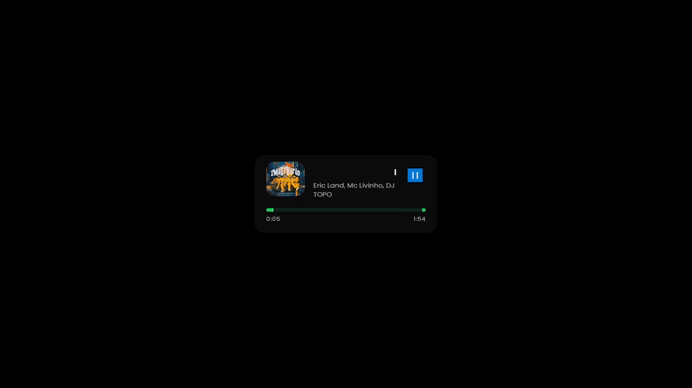

# 🎵 Spotify Widget para OBS

Este é um widget simples que mostra a música que você está ouvindo no Spotify diretamente no OBS, com visual moderno e integração via navegador.

## 🖼️ Preview

Veja como o widget aparece no OBS:
O background que esta na preview é ilustrativo.




## ✅ Recursos

- Exibe nome da música, artista, álbum e capa.
- Atualização em tempo real com base no Spotify.
- Compatível com fontes de navegador do OBS.
- Leve, simples e local (sem necessidade de servidor externo).

## 🖥️ Como usar

1. **Autenticação Spotify**
   - Execute o arquivo `index.exe`.
   - Faça login na sua conta Spotify quando o navegador abrir.
   - Após o login, pode fechar a aba. O servidor continuará rodando.

2. **Adicionar no OBS**
   - Vá até o OBS, adicione uma **Fonte de Navegador**.
   - Em "URL", use o caminho completo para `widget.html`.  
     Exemplo:  
     `file:///C:/Users/seu-nome/Downloads/Spotify-Widget/widget.html`
   - Ajuste o tamanho como quiser (ex: 600x150).

3. **Personalização**
   - Edite o `widget.html` e `style.css` como quiser para mudar o visual.

## 🧾 Requisitos

- Conta no Spotify.
- Python (caso queira rodar o código fonte em vez do `.exe`).
- OBS Studio (ou outro software que aceite fontes via navegador).

## 📦 Executável

O index.exe ja esta pronto, ja o index.py caso vc queira fazer mudanças e depois use o comando abaixo.

Se quiser compartilhar o widget com outras pessoas, gere o executável com:

```bash
pyinstaller --onefile --icon=icone.ico index.py
by-ian
